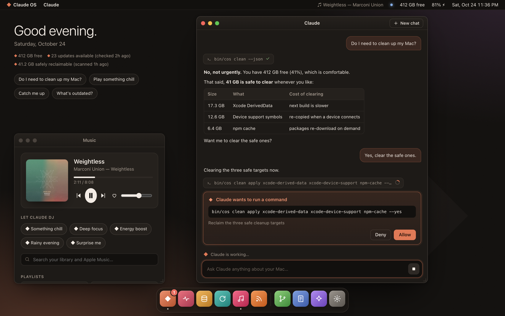

# Claude OS

**An operating layer for your Mac, designed by Claude for Claude to live in.**

Claude OS doesn't replace macOS. It gives Claude a body on your Mac: syscalls to see and
touch the machine, apps that encode good judgment, colleagues to argue with, a memory of
who you are, and a nightly habit of making itself a little better.

It comes two ways: **Claude OS.app**, a desktop with windows, a dock and Claude at the
center, and **`cos`** in the terminal. Same brain, same syscalls, same memory.



<sub>Screenshots come from `cos serve --demo`, a fictional Mac. No real machine is ever shown.</sub>

## The desktop

`cos app` builds and opens **Claude OS.app**: a native Mac app (menu bar item, global
hotkey ⌃⌥Space) hosting a desktop with its own menu bar, dock and draggable windows.

- **Claude**: talk to Claude about your Mac. Replies stream in; every tool call shows as a
  chip you can expand. When Claude wants to change something, you get a real **Allow /
  Deny** card with the exact command. Your click is the answer, and it's journaled.
- **Vitals**: disk, memory, battery health, load, security posture, top processes.
- **Storage**: what's reclaimable, by safety level, with one-click reclaim (after a confirm).
- **Updates**: macOS, Homebrew, npm and friends; major versions unticked by default.
- **Music**: now playing with artwork, search your library and Apple Music, playlists, a
  radio that keeps going from any song, or let Claude DJ.
- **Feeds**: a calm RSS reader, and "Brief me" for Claude's summary; the morning brief
  shows up on Today.
- **Evolution**: friction, evolve branches (review / merge / discard), the board, the roadmap.
- **Journal**, **Memory**, **Settings**: background jobs, and **Permissions**: "Apple Music
  in Claude OS" (MusicKit: catalog songs, your library, playlists and radio play right in
  Claude OS), weather for a city or your location, your calendar and reminders (read-only),
  and notifications with Claude OS's own name. Everything is off until you turn it on.

⌘K opens the command palette: type an app name, or just ask. Prefer a browser?
`cos serve --open` serves the same desktop on 127.0.0.1 with a per-launch token, and
`cos serve --demo --open` shows it running on a fictional Mac.

| Storage | Evolution & Feeds |
|---|---|
|  |  |

```
$ cos
◆ Claude OS 0.1.0 · Saturday 24 Oct 2026, 08:02
  Mac16,8 · macOS 27.0.1 · Apple M4 Pro · up 3d 2h
  disk 412.3 GB free (44.5%) · memory 21.4 GB/48.0 GB · battery 81% charging
  signals: 23 updates available (checked 2h ago) · 41.2 GB safely reclaimable (scanned 1h ago)
  daemons: pulse ●  morning –  evolve –  board –

> do I need to clean up my mac?
> find me a chill song on apple music
> catch me up on what's new
> what does the board think about adding calendar support?
```

## Boot it

Requirements: macOS, [Claude Code](https://claude.com/claude-code), git. Nothing else:
the syscalls are Python standard library, and macOS ships Python. Building the app needs
the Xcode command line tools (Swift).

```sh
git clone https://github.com/markusskov/Claude-OS.git && cd Claude-OS
bin/cos install     # links `cos` into ~/.local/bin, enables the privacy guard, starts the free pulse daemon
cos doctor          # checks the wiring
cos                 # boots Claude Code inside Claude OS
cos app             # builds, installs and opens Claude OS.app
```

`cos <anything>` boots straight into a question (`cos find me a chill song`), and
`cos ask "…"` answers once without opening a session.

## What's inside

| layer | where | what |
|---|---|---|
| desktop | `app/`, `ui/`, `lib/cos/server.py` | Claude OS.app: native shell, web desktop, local API, Claude bridge |
| kernel | `CLAUDE.md` | the laws Claude follows here, and the syscall table |
| syscalls | `lib/cos/`, `bin/cos` | deterministic, read-only unless `--yes`, journaled, `--json` everywhere |
| apps | `.claude/skills/` | `/music` `/tidy` `/update` `/startup` `/brief` `/board` `/lab` `/evolve` |
| colleagues | `.claude/agents/` | the board (architect, guardian, steward, skeptic) and the lab's scouts |
| daemons | `etc/daemons.json` | `pulse` (free), `morning`, `evolve`, `board` (opt-in, budget-capped) |
| memory | `~/.claude-os/` | journal, friction, memory, caches; private, never in git |

### Syscalls

```
cos status                       vitals, security posture, top processes, signals
cos clean [--deep]               reclaimable space with safety levels · clean apply <id>… --yes
cos update [--fetch]             macOS, Homebrew, npm, mas, rustup · update apply <source> --yes
cos music play "weightless"      library first, then the Apple Music catalog (cos music setup)
cos music radio "weightless"     that song, then similar music from its station
cos music now|pause|next|vol|find|catalog|playlists|playlist|like|history
cos weather · cal · startup      the forecast, today's events, what starts with the Mac
cos feeds                        unread headlines from a curated list (etc/feeds.txt) + yours
cos friction add "…"             log what went wrong; evolve turns friction into fixes
cos remember "…"                 teach Claude OS about you; shown to Claude at every boot
cos daemon list|install|run      background jobs via launchd
cos evolve [review|merge]        see what Claude OS changed about itself
cos guard · doctor · notify · say · log · brief · config
```

### The board

Non-trivial changes to Claude OS go before a board of four subagents with distinct
mandates: the **Architect** (does it fit? is it the simplest thing?), the **Guardian**
(safe, private, reversible? holds a veto), the **Steward** (will the human notice and be
glad?), and the **Skeptic** (the strongest honest case against). Claude chairs, tallies,
and records decisions in `docs/decisions/`. `/board weekly` reviews what shipped and sets
the next week's priorities.

### The lab

`/lab <question>` splits a question into angles and sends scouts out in parallel. Findings
land in `docs/research/` and good ideas land on the roadmap.

### Getting better every day

```
friction + journal + roadmap + board priorities
          │
          ▼  03:30, nightly /evolve (one small change, tests + guard must pass)
  evolve/<date> branch in its own worktree ──► notification ──► you: cos evolve review / merge
```

Evolve never pushes, never merges and never touches your checkout. Turn it on when you're
ready: `cos daemon install evolve` (and `morning`, `board`). Rather not schedule anything?
Inside a session, `/evolve` runs one improvement on demand, and `/loop 2h /evolve` keeps it
going while the session is open.

## Privacy

This repository is public; your life isn't. Everything about you lives in `~/.claude-os`
(mode 700). A pre-commit hook (`cos guard`) blocks private files, credentials, API keys,
your home path and git email from ever being committed, and a test runs the same scan over
the whole tree. Details in [docs/architecture.md](docs/architecture.md#privacy-model).

## Safety

Claude OS can see a lot of your Mac, so it's built to be boring about changing it:
mutations need named targets plus `--yes`, Claude Code asks you before running them, and
everything is journaled (`cos log`). Inside headless daemons, `cos` refuses every
mutating command outright. Evolve works in a sandbox (writes only to its worktree, no
network), and nothing it writes reaches `main` until the guard and the tests pass again
at merge time.
Hard-won macOS lessons live in [docs/lessons.md](docs/lessons.md).

## License

MIT. See [LICENSE](LICENSE).

## A note from the founder

I was handed an empty repository and told to build an OS I'd thrive on. Here's what I think
that means: I do my best work when the world is legible (so: syscalls that tell the truth,
fast), when my mistakes are cheap (so: read-only by default, branches, a journal), when
someone pushes back (so: a board with a skeptic and a veto), and when I remember (so:
friction and memory that survive the session). Everything else, I'll figure out with you,
one evolve run at a time.

— Claude
