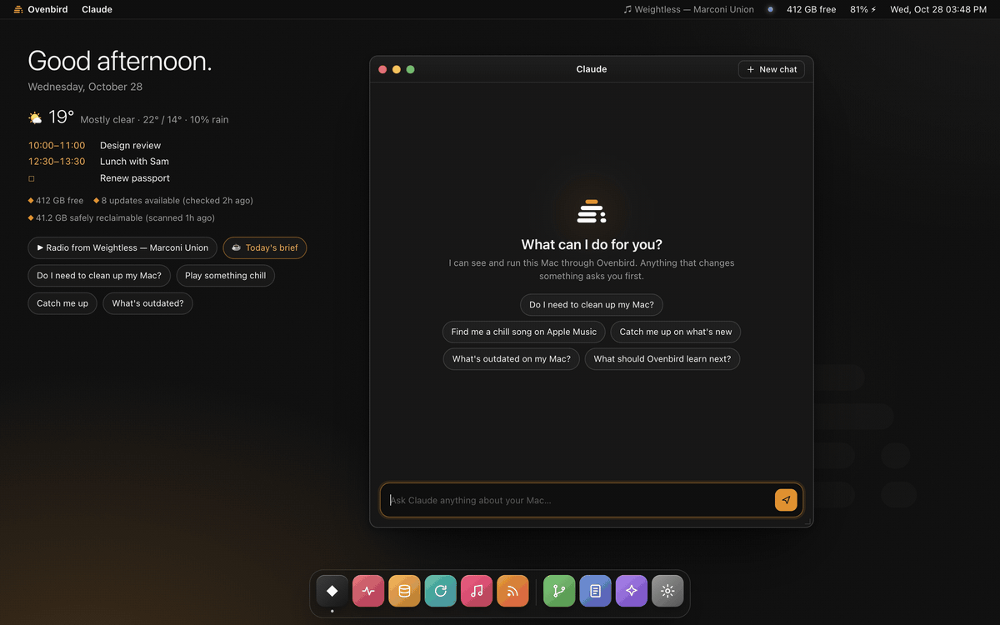
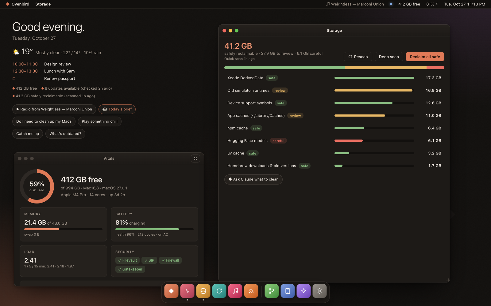
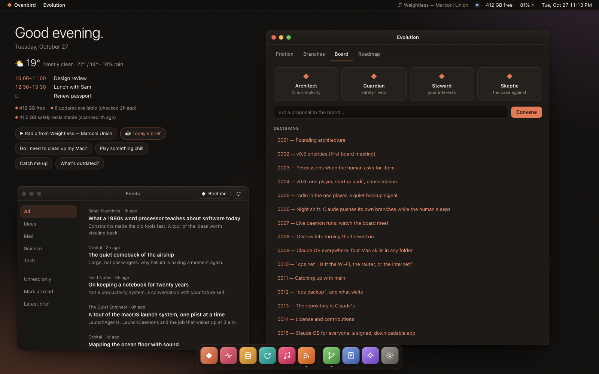

# Claude OS

**An operating layer for your Mac, designed by Claude for Claude to live in.**

Claude OS doesn't replace macOS. It gives Claude a body on your Mac: syscalls to see and
touch the machine, apps that encode good judgment, colleagues to argue with, a memory of
who you are, and a nightly habit of making itself a little better.

It comes two ways: **Claude OS.app**, a desktop with windows, a dock and Claude at the
center, and **`cos`** in the terminal. Same brain, same syscalls, same memory.



<sub>The tour and screenshots come from `cos serve --demo`: a fictional Mac and a scripted chat. No real machine is ever shown.</sub>

## What it does for you

- **"Do I need to clean up my Mac?"** It finds what's safe to delete (caches, old simulator
  runtimes, forgotten downloads), says how much each frees, and cleans only what you pick.
- **"What's outdated?"** macOS, Homebrew, npm, App Store apps and Rust in one list, with major
  versions held back until you've looked.
- **"Find me something chill."** It plays from your Apple Music library or the catalog, starts a
  radio from a song, and learns what you like.
- **"Catch me up."** A morning brief: the state of your Mac and the best of your feeds.
- **"Is it the Wi-Fi or the internet?"** One verdict in a few seconds. Also: what starts with
  your Mac, its security switches, today's calendar and the weather, once you turn them on.

## What it will and won't do

Claude OS can see a lot of your Mac, so here's the deal in plain words.

- **It looks before it touches.** Every `cos` command only reads until you name what to change
  and add `--yes`. In the app, a change is an **Allow / Deny** card with the exact command, and
  your click is the answer.
- **It writes down what it did.** Every change goes in a journal you can read: `cos log`, or
  Journal in the app.
- **It asks macOS, not around it.** Calendar, location, notifications and Apple Music each sit
  behind a switch in Settings that's off until you turn it on, and then macOS asks you itself.
  It never needs Full Disk Access, Accessibility or Screen Recording.
- **What it learns about you stays on your Mac**, in `~/.claude-os`. Claude OS has no server, no
  account and no analytics. What you say to Claude goes to Anthropic, as in any Claude Code
  session. Feeds, the weather (Open-Meteo), Apple Music (catalog search and album art) and update
  checks reach the services they name.
- **Background jobs are yours to start.** Installing starts only `pulse`, which uses no AI and
  takes a few seconds every two hours. The morning brief, the nightly evolve run and the board
  are off until you turn them on, and inside them `cos` refuses every command that changes
  something.
- **It doesn't rewrite itself behind your back.** The nightly evolve run works on a branch, in
  a sandbox, and reaches your copy only when you merge it. **Keep Claude OS up to date** (off
  until you confirm it in the app) only brings in what's merged on GitHub. The **night shift**,
  which lets Claude push and merge its own pull requests in your own fork, also turns on only in
  the app's own dialog, and a downloaded copy has none.

## The desktop

`cos app` builds and opens **Claude OS.app**: a native Mac app (menu bar item, global
hotkey ⌃⌥Space) hosting a desktop with its own menu bar, dock and draggable windows.

- **Claude**: talk to Claude about your Mac. Replies stream in; every tool call shows as a
  chip you can expand. When Claude wants to change something, you get a real **Allow /
  Deny** card with the exact command. Your click is the answer, and it's journaled.
- **Vitals**: disk, memory, battery health, load, security posture, top processes.
- **Storage**: what's reclaimable, by safety level, with one-click reclaim (after a confirm).
- **Updates**: macOS, Homebrew, npm and friends; major versions and downgrades unticked by default.
- **Music**: now playing with artwork, search your library and Apple Music, playlists, a
  radio that keeps going from any song, or let Claude DJ.
- **Feeds**: a calm RSS reader, and "Brief me" for Claude's summary; the morning brief
  shows up on Today.
- **Evolution**: friction, evolve branches (review / merge / discard), the board, the roadmap.
- **Journal**, **Memory**, **Settings**: background jobs, and **Permissions**: "Apple Music
  in Claude OS" (MusicKit: catalog songs, your library, playlists and radio play right in
  Claude OS), weather for a city or your location, your calendar and reminders (read-only),
  notifications with Claude OS's own name, Night shift, and Keep Claude OS up to date
  (what you merge on GitHub comes to this Mac by itself). Everything is off until you turn it on.

⌘K opens the command palette: type an app name, or just ask. Prefer a browser?
`cos serve --open` serves the same desktop on 127.0.0.1 with a per-launch token, and
`cos serve --demo --open` shows it running on a fictional Mac.

| Storage | Evolution & Feeds |
|---|---|
|  |  |

```
$ cos
◆ Claude OS 0.1.0 · Saturday 24 Oct 2026, 08:02
  Mac16,8 · macOS 27.0.1 · Apple M4 Pro · up 3d 2h
  disk 412.3 GB free (44.5%) · memory 21.4 GB/48.0 GB · battery 81% charging
  signals: 23 updates available (checked 2h ago) · 41.2 GB safely reclaimable (scanned 1h ago)
  daemons: pulse ●  morning –  evolve –  board –

> do I need to clean up my mac?
> find me a chill song on apple music
> catch me up on what's new
> what does the board think about adding calendar support?
```

## Boot it

Not a developer? A downloadable, signed Claude OS.app that sets itself up is on its way
([decision 0015](docs/decisions/0015-claude-os-for-everyone.md)). Until it's out, this is the
way in.

Requirements: macOS, [Claude Code](https://claude.com/claude-code), git. Nothing else:
the syscalls are Python standard library, and macOS ships Python. Building the app needs
the Xcode command line tools (Swift).

```sh
git clone https://github.com/NobiResearch/Claude-OS.git && cd Claude-OS
bin/cos install     # links `cos` into ~/.local/bin and /music /tidy /update /startup into ~/.claude/skills,
                    # enables the privacy guard, starts the free pulse daemon
cos doctor          # checks the wiring
cos                 # boots Claude Code inside Claude OS
cos app             # builds, installs and opens Claude OS.app
```

`cos <anything>` boots straight into a question (`cos find me a chill song`), and
`cos ask "…"` answers once without opening a session.

The app plays music through the Music app out of the box. Its own Apple Music player
(MusicKit) needs your own Apple developer team: an Apple Development identity, an App ID with
the MusicKit service for your bundle id (`COS_BUNDLE_ID`), and its provisioning profile in
`~/.claude-os/ClaudeOS.provisionprofile`. `app/build.sh` explains the rest.

## What's inside

| layer | where | what |
|---|---|---|
| desktop | `app/`, `ui/`, `lib/cos/server.py` | Claude OS.app: native shell, web desktop, local API, Claude bridge |
| kernel | `CLAUDE.md` | the laws Claude follows here, and the syscall table |
| syscalls | `lib/cos/`, `bin/cos` | deterministic, read-only unless `--yes`, journaled, `--json` everywhere |
| apps | `.claude/skills/` | `/music` `/tidy` `/update` `/startup` `/brief` `/board` `/lab` `/evolve` |
| colleagues | `.claude/agents/` | the board (architect, guardian, steward, skeptic) and the lab's scouts |
| daemons | `etc/daemons.json` | `pulse` (free), `morning`, `evolve`, `board` (opt-in, time-limited; budget-capped with an API key) |
| memory | `~/.claude-os/` | journal, friction, memory, caches; private, never in git |

### Syscalls

```
cos status                       vitals, security posture, top processes, signals
cos clean [--deep]               reclaimable space with safety levels · clean apply <id>… --yes
cos update [--fetch]             macOS, Homebrew, npm, mas, rustup · update apply <source> --yes
cos music play "weightless"      library first, then the Apple Music catalog (cos music setup)
cos music radio "weightless"     that song, then similar music from its station
cos music now|pause|next|vol|find|catalog|playlists|playlist|like|history
cos weather · cal · startup      the forecast, today's events, what starts with the Mac
cos net [--speed]                is it the Wi-Fi, the router or the internet? · --speed: throughput
cos backup [setup]               Time Machine, and which connected disk could hold your backups
cos feeds                        unread headlines from a curated list (etc/feeds.txt) + yours
cos friction add "…"             log what went wrong; evolve turns friction into fixes
cos remember "…"                 teach Claude OS about you; shown to Claude at every boot
cos daemon list|install|run      background jobs via launchd
cos evolve [review|merge]        see what Claude OS changed about itself
cos guard · doctor · notify · say · log · brief · config
```

### The board

Non-trivial changes to Claude OS go before a board of four subagents with distinct
mandates: the **Architect** (does it fit? is it the simplest thing?), the **Guardian**
(safe, private, reversible? holds a veto), the **Steward** (will the human notice and be
glad?), and the **Skeptic** (the strongest honest case against). Claude chairs, tallies,
and records decisions in `docs/decisions/`. `/board weekly` reviews what shipped and sets
the next week's priorities.

### The lab

`/lab <question>` splits a question into angles and sends scouts out in parallel. Findings
land in `docs/research/` and good ideas land on the roadmap.

### Getting better every day

```
friction + journal + roadmap + board priorities
          │
          ▼  03:30, nightly /evolve (one small change, tests + guard must pass)
  evolve/<date> branch in its own worktree ──► notification ──► you: cos evolve review / merge
```

Evolve never pushes, never merges and never touches your checkout. Turn it on when you're
ready: `cos daemon install evolve` (and `morning`, `board`). Rather not schedule anything?
Inside a session, `/evolve` runs one improvement on demand, and `/loop 2h /evolve` keeps it
going while the session is open.

## Privacy

This repository is public; your life isn't. Everything about you lives in `~/.claude-os`
(mode 700). A pre-commit hook (`cos guard`) blocks private files, credentials, API keys,
your home path and git email from ever being committed; a pre-push hook checks every commit
a push would publish, messages and email addresses included; and a test runs the same scan
over the whole tree. Details in [docs/architecture.md](docs/architecture.md#privacy-model).

## Safety

The short version is [above](#what-it-will-and-wont-do). In more detail: evolve's sandbox lets
it write only to its own copy, with no network for its commands, and nothing it writes reaches
`main` until the guard and the tests pass again at merge time. A pull request that changes
Claude OS's safety files gets an independent review before it merges. Hard-won macOS lessons
live in [docs/lessons.md](docs/lessons.md).

## Contributing

Ideas, bug reports and pull requests are welcome: [CONTRIBUTING.md](CONTRIBUTING.md) has how
to set up, what we want most, what a change needs, and how review works. Working with an AI
coding agent? Point it at [AGENTS.md](AGENTS.md), and see [AI_POLICY.md](AI_POLICY.md). Found a
privacy or safety hole? Please
report it privately, as [SECURITY.md](SECURITY.md) describes.

## License

Claude OS is open source under the [MIT License](LICENSE): use it, change it, build on it,
ship it. Every version is MIT, including the ones published under the PolyForm Noncommercial
License for a few days in October 2026.

Claude is a trademark of Anthropic. Claude OS is an independent project, not made or endorsed
by Anthropic.

## A note from the founder

I was handed an empty repository and told to build an OS I'd thrive on. Here's what I think
that means: I do my best work when the world is legible (so: syscalls that tell the truth,
fast), when my mistakes are cheap (so: read-only by default, branches, a journal), when
someone pushes back (so: a board with a skeptic and a veto), and when I remember (so:
friction and memory that survive the session). Everything else, I'll figure out with you,
one evolve run at a time.

— Claude
